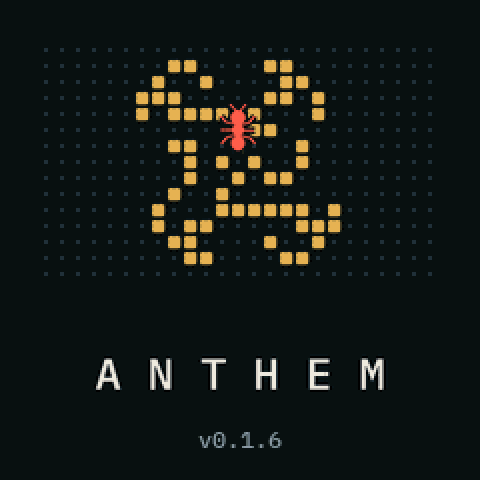
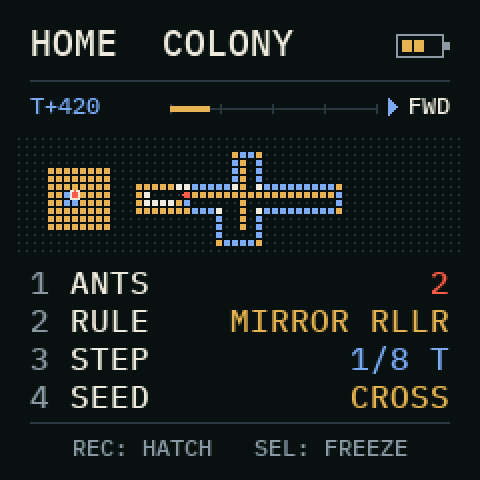
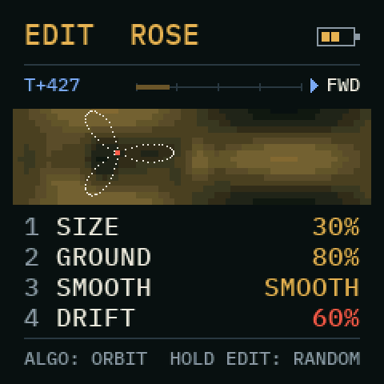
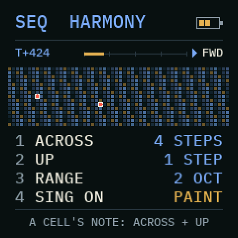

# ANTHEM

  
  

  
  

> [!WARNING]
> **Not tested on a real FM‑1 yet.** ANTHEM has only been tested on a computer. Install it on your FM‑1 at your own risk, and keep the stock firmware or another firmware ready to flash back.

ANTHEM is a firmware for the **M‑VAVE FM‑1** where **a colony of ants writes the music, and time runs both ways**.

Up to four ants walk a ground of cells. On every step an ant looks at the colour under it, turns as its RULE says,
paints the cell the next colour and walks on: a *turmite*, Langton's ant and its family. From a bare ground comes a
scribble, then order (a square, a mirror, a highway), then chaos again. **Each step, the ant sings the note of its
cell.** Nothing is random: the same seed and the same rule always give the same song.

And the rule runs **backwards, exactly**. Press **OCT−** and the ants step back, un-paint, un-turn: the colony
un-writes itself, singing its song in reverse, all the way back to the moment it hatched (and on, into a past nobody
wrote). **OCT+** and they go forward again.

- **The colony (HOME)**: ANTS (1 to 4), RULE (LANGTON, SQUARE, MIRROR, CHAOS, CLOUD, KNOT, WEAVE, CORAL, SPIRAL),
  STEP (1/4 .. 1/32), SEED (the ground it hatches on; on its cells the ants sing an octave higher). **REC hatches** a new colony; **SEL freezes** the paint: the
  ground stops changing, the walk closes into a loop, the music repeats. SEL again and they write on.
- **Time**: **OCT− backwards, OCT+ forwards**, at the same speed; hold one and press the other: twice as fast, the
  way the first one set. **SELECT walks time by
  hand**, a step a detent, either way, playing or stopped.
- **The map (SEQ)**: a cell's note is ACROSS scale steps for each column and UP for each row, folded into RANGE
  octaves. ACROSS 4, UP 2 in a seven-note scale is a **Tonnetz**: fifths one way, thirds the other. SING ON: the
  painted cells, the bare ones, or every step.
- **The sound is the ground (EDIT)**: **wave terrain synthesis**. The paint is a landscape of heights; each note draws
  an ORBIT over it (CIRCLE, EIGHT, ROSE, DIAMOND, LINE on ALGORITHM) at the note's frequency, and the heights it
  passes are the wave. DRIFT centres the orbit where the ant stands: **every ant sounds like the ground under its
  feet**, and as they paint, the timbre changes with the music. SIZE, GROUND (how high the paint stands), SMOOTH.
  **Hold EDIT on the EDIT page: a random sound** (the orbit, EDIT, ENV and LFO).
- **ENV is every footstep**: ATTACK, DECAY, ACCENT (the later colours louder), BLOOM (the orbit opens at each step).
- **LFO, the wind**: SIZE, SHIFT (the orbits slide over the ground), PITCH or LEVEL.
- **The ARP is a chord the ants sing**: hold keys and every cell's note goes to the nearest note of your chord (or
  they take its notes IN TURN), SPREAD over octaves, with a CHANCE that is the same forwards and backwards.
- **Only the ants sing.** The keys never play the engine: on every page they set the root (on the ARP page, the
  chord). **48 scales**, common and exotic.
- **The time line is on every page**: the colony's age (T+123), how much of the ground is painted, which way time runs.
- **Dinghy inside**: MIDI clock sync, MIDI in and out (every note the ants sing goes out), USB audio, FM‑1 Mirror, the
  backup page.
- **8 presets and 8 USER slots** that SAVE keeps: the sound, the map, the scale, **and the colony itself**.
- **Every page says what it does**, one page each, no menus inside menus.

[Read the operator manual](docs/OPERATOR-MANUAL.md) · [Credits and licenses](LICENSING.md) · [Changelog](CHANGELOG.md)

**Version 0.1.6** builds as `anthem.fwsc` (a tagged release: `anthem-0.1.6.fwsc`). The host tests pass. It has **not yet
been installed on a physical FM‑1**.

## Build

ANTHEM builds like [Dinghy](https://github.com/zvenson/dinghy), the platform it is written on: Python 3 with Pillow,
the JieLi toolchain (`tools/get_toolchain.sh`) and three files of the JieLi AC79 SDK, then `sh build.sh` (macOS:
through Docker). `sh tests/run_host.sh` runs ANTHEM on your computer: the screens as PNG, the sound as WAV
(`tests/scripts/listen.txt`: a minute of the eight presets). Every push to `main` builds the package on GitHub and
leaves it on the `build` branch.

## Credits

ANTHEM is written on [Dinghy](https://github.com/zvenson/dinghy) by zvenson (its platform, MIDI clock sync, MIDI,
mirror and backup kit), which carries the [Felucca](https://github.com/hugelton/Felucca) and
[SLOOP](https://github.com/isod89/sloop-fm1) platform work. The delay, hall, chorus, the scales and the look of the
pages come from [LOOPHEADS](https://github.com/jaak-stjaaques/LOOPHEADS-public),
[BEACHCOMBER](https://github.com/jaak-stjaaques/Beachcomber), [BUOY](https://github.com/jaak-stjaaques/BUOY) and
[PLUMB](https://github.com/jaak-stjaaques/Plumb). The screen font is [IBM Plex Mono](https://github.com/IBM/plex).
Langton's ant is Chris Langton's (1986); the Tonnetz is Euler's and Riemann's; wave terrain synthesis is Rich Gold's,
John Bischoff's and Yasuhiro Mitsuhashi's.

The firmware is distributed under [GPL-3.0-only](LICENSE). The [full credits](LICENSING.md) keep the upstream notices
and list the separately licensed assets.
