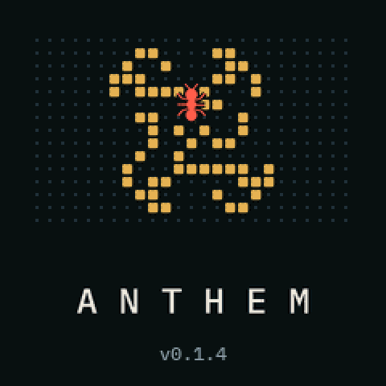
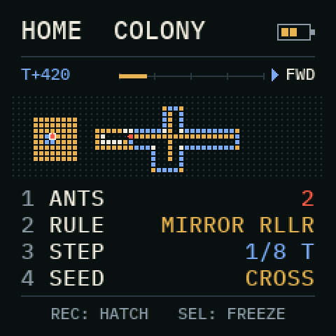
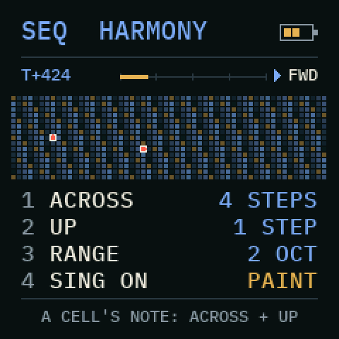
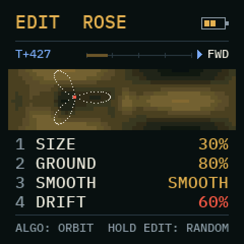
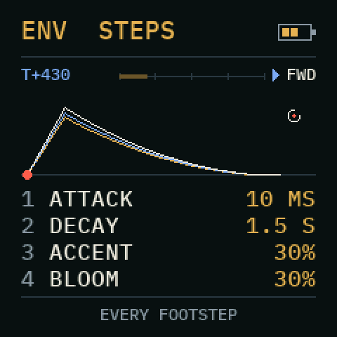
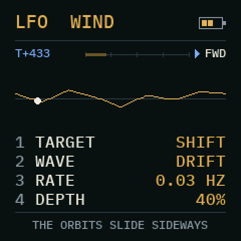
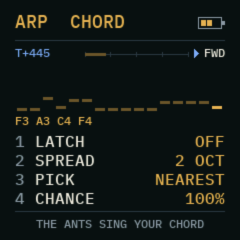
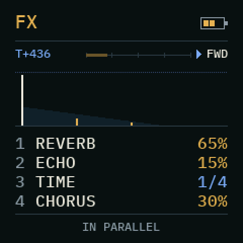
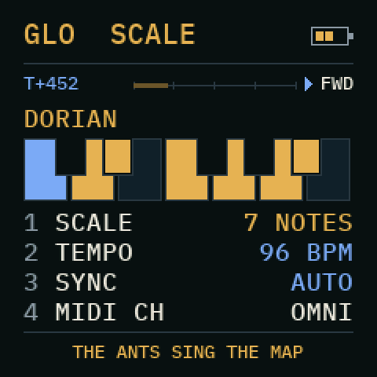

# ANTHEM operator manual

ANTHEM 0.1.4 for the M‑VAVE FM‑1. A colony of ants writes the music, and time runs both ways.

## The idea in one minute

<p align="center"></p>

Up to four ants walk a ground of 56 x 15 cells. A cell is bare or painted in one of three colours (amber, blue,
chalk). On every step, each ant:

1. **sings** the note of the cell it stands on,
2. **turns** as the RULE says for that colour (LANGTON is `RL`: right on a bare cell, left on a painted one),
3. **paints** the cell the next colour,
4. and **walks on** one cell. Off one edge, on at the other.

That is all, and it is enough: from a bare ground a single ant scribbles for a long time, then, with Langton's rule,
suddenly builds a straight "highway". Other rules grow squares, mirrors, clouds, knots. **Nothing is random**: the same
seed and the same rule always give the same song.

The rule can be run **backwards, exactly**. **OCT−** turns time back: the ants step back, un-paint and un-turn, the
colony un-writes itself and sings its song in reverse, back to the moment it hatched. **OCT+** and time goes forward.

The ground is also **the sound**. Every note draws an orbit over the landscape the paint makes (wave terrain synthesis),
centred where the ant stands: each ant sounds like the ground under its feet, and the timbre changes as they paint.

The colours on the screen: **amber, blue, chalk** are the paint; **red** are the ants; **blue** is time.

## On every page

```
HOME  COLONY               [battery]     the page
T+420 ━━━━──┼───┼───┼───   ▶ FWD          the time line: the colony's age in steps, how much is painted, which way
[ the picture ]
1 ANTS                  2                the four knobs, KNOB 1..4
2 RULE        MIRROR RLLR
3 STEP              1/8 T
4 SEED              CROSS
REC: HATCH   SEL: FREEZE                 what a button does here, or what just happened
```

The word at the right of the time line: **FWD** (forward), **BACK** (backwards), **LOOP** (frozen), **STOP** (the
transport is stopped). Two white arrows: time runs twice as fast (both OCT buttons held).

ANTHEM is silent at power-on: the ants wait until you press **PLAY**.

## The panel

| Control | What it does |
| --- | --- |
| **PLAY/STOP** | The ants walk, or stop where they are. A MIDI clock's START does the same, on the DAW's downbeat |
| **OCT−** | **Time runs backwards**, at the same speed as forwards. Holding OCT+, press OCT−: **forwards, twice as fast**, as long as you hold both. (On the GLO page: the root an octave down) |
| **OCT+** | **Time runs forwards.** Holding OCT−, press OCT+: **backwards, twice as fast**, as long as you hold both. (On the GLO page: the root an octave up) |
| **REC** | **Hatch**: a new colony on the SEED, the ants back in their places, time back to 0 |
| **SEL** | **Freeze**: the ants walk on but no longer paint. On a ground that does not change, their walk soon closes into a loop and the music repeats. SEL again: they paint again, and the music moves on |
| **HOME, SEQ, ARP, EDIT, ENV, LFO, FX, GLO** | Their page. **ARP** pressed on the ARP page turns the chord on or off. **EDIT held 300 ms on the EDIT page**: a random sound |
| **SAVE** | Saves everything (the sound, the map, the scale **and the colony as it stands**) into the USER preset you are on, or the last one you used |
| **SELECT** (encoder) | **Walks time by hand**: a step forward or back for each detent, playing or stopped. On the GLO page: the scale |
| **ALGORITHM** (encoder) | The orbit's shape: CIRCLE, EIGHT, ROSE, DIAMOND, LINE |
| **PRESETS** (encoder) | The 8 presets and the 8 USER slots |
| **KNOB 1..4** | The four rows of the page |
| **Keys** | Play the ground (the sound under the first ant, snapped to the scale). With the ARP on: the chord the ants sing. On GLO: the root |
| **MASTER** | The volume |

The keys light up when an ant sings their note. OCT+ or OCT− is lit for the way time runs, SEL while frozen.

## HOME: the colony

<p align="center"></p>

The ground: bare cells are faint dots, painted ones amber, blue or chalk. The ants are red, with a dot for their head
(the way they go); an ant flashes white when it sings.

| Knob | | |
| --- | --- | --- |
| 1 | **ANTS** | How many walk, 1 to 4. They start spread along the middle, each facing another way |
| 2 | **RULE** | What an ant does on each colour: R right, L left, N straight on, U about turn. LANGTON `RL` (chaos, then a highway), SQUARE `LLRR` (a square that grows), MIRROR `RLLR` (symmetric shapes), CHAOS `RLR`, CLOUD `RNNL`, KNOT `LRRR`, WEAVE `LLRL`, CORAL `LRL`, SPIRAL `RRLU`. Changing it while they walk is allowed, and makes a new world |
| 3 | **STEP** | How often they step: 1/4, 1/8, 1/8 T, 1/16, 1/16 T, 1/32 |
| 4 | **SEED** | The ground a new colony hatches on: BARE, ONE DOT, DASHES, CROSS, RING, DUST, MOSS, STRIPES. Press **REC** to hatch on it. **On the seed's cells the ants sing an octave higher**, for the colony's whole life, painted over or not: you hear the seed. A seed's cell walked bare keeps a faint amber dot |

## SEQ: the harmony

<p align="center"></p>

There is no step sequencer: the ants are the sequencer. This page says **which note each cell sings**. The picture
colours every cell by its note (low dark, high bright blue), the roots amber. The seed's cells (an octave up) show in
chalk.

| Knob | | |
| --- | --- | --- |
| 1 | **ACROSS** | Scale steps from one column to the next, 0 to 12 |
| 2 | **UP** | Scale steps from one row to the one above, 0 to 12 |
| 3 | **RANGE** | Folded into 1 to 4 octaves around the root |
| 4 | **SING ON** | PAINT (only on painted cells: bare ground is a rest), BARE (the other way round) or EVERY STEP |

ACROSS 4 and UP 2 in a seven-note scale is a **Tonnetz**: walking right goes up a fifth, walking up a third. An ant
walking straight plays a line; an ant turning in a square plays a little cadence.

## EDIT: the terrain

<p align="center"></p>

**Wave terrain synthesis.** The ground, as heights (amber is high), smoothed, on a round hill. Every note draws an
orbit over this landscape, once per cycle of its pitch; the heights it passes over are its wave. The picture shows the
landscape and, in white, the orbit of the first ant's next note.

| Control | | |
| --- | --- | --- |
| ALGORITHM | **ORBIT** | CIRCLE (round), EIGHT, ROSE (three petals), DIAMOND, LINE (all the way across, a whole row read as a wave) |
| 1 | **SIZE** | How big the orbit is: small is soft and round, big crosses more paint and is brighter. High notes get a smaller one |
| 2 | **GROUND** | How high the paint stands on the hill: 0 % is just the hill (a near sine), 100 % the colony's paint at full height |
| 3 | **SMOOTH** | RAW, GRAIN, SOFT, SMOOTH, MIST: how much the landscape is smoothed. Rough is bright and buzzy |
| 4 | **DRIFT** | 0 %: every orbit in the middle of the landscape. 100 %: centred where the ant stands, so each ant sounds like the ground under it |

As the ants paint, the landscape changes, and so does the sound: slowly, never with a click.

**A random sound: on the EDIT page, hold EDIT for 300 ms.** The orbit, the four EDIT knobs, ENV (ATTACK, DECAY,
ACCENT, BLOOM) and the LFO (TARGET, WAVE, RATE, DEPTH) get new values, within ranges that still sound like an
instrument: mostly short attacks, decays from 0.2 to 10 s, a gentle LFO. The colony, the map, the scale and FX stay as
they are. Hold again for another; SAVE keeps one you like. (Only from the EDIT page itself: pressing EDIT elsewhere
just opens it.)

## ENV: every footstep

<p align="center"></p>

| Knob | | |
| --- | --- | --- |
| 1 | **ATTACK** | 0 ms to 20 s |
| 2 | **DECAY** | How long a footstep rings, up to 10 s (and how long a key rings after you let go). Many long notes at once are kept from distorting: the level comes down smoothly instead |
| 3 | **ACCENT** | How much louder the later colours are: amber softest, chalk loudest |
| 4 | **BLOOM** | The orbit opens at each footstep and closes as it decays: brighter at the start |

## LFO: the wind

<p align="center"></p>

TARGET: **SIZE** (the orbits grow and shrink), **SHIFT** (the orbits slide sideways over the ground: the timbre moves
under every note), **PITCH**, **LEVEL**. WAVE: SINE, TRIANGLE, RANDOM, DRIFT. RATE 0.01 to 20 Hz. DEPTH.

## ARP: the chord

<p align="center"></p>

Press ARP on the ARP page to turn it on. Then **hold a chord**: the ants sing only its notes.

| Knob | | |
| --- | --- | --- |
| 1 | **LATCH** | ON: the chord stays when you let go (a new chord replaces it) |
| 2 | **SPREAD** | The chord over 1 to 4 octaves |
| 3 | **PICK** | NEAREST: each cell's note goes to the nearest note of the chord (the map still shapes the melody). IN TURN: the cells take the chord's notes in turn |
| 4 | **CHANCE** | How often an ant sings. The chance of each step is fixed: backwards, the same notes are left out |

## FX

<p align="center"></p>

REVERB, ECHO, TIME (the echo, 1/32 to a dotted 1/4, on the tempo) and CHORUS, in parallel.

## GLO

<p align="center"></p>

| Knob | | |
| --- | --- | --- |
| 1 | **SCALE** | 48 scales (also SELECT). The piano shows it, the root in blue |
| 2 | **TEMPO** | 40 to 240 BPM; "MIDI" when a clock leads |
| 3 | **SYNC** | AUTO (a MIDI clock that comes in leads) or INTERNAL |
| 4 | **MIDI CH** | OMNI or 1..16, in and out |

The keys set the root (C4 = C), OCT− / OCT+ move it an octave.

## Presets

| | | |
| --- | --- | --- |
| 1 | FIRST STEPS | One ant, LANGTON on a bare ground, a circle, major: the classic, from the first step |
| 2 | SQUARE DANCE | Two ants, SQUARE from one dot, a diamond, major pentatonic, on 1/8 |
| 3 | MIRROR HALL | Two ants, MIRROR on a cross, a rose, dorian, 1/8 T |
| 4 | LEAFCUTTER | Three ants, CHAOS on dust, the line orbit, minor pentatonic, fast |
| 5 | NIGHT MARCH | Four ants, KNOT on a ring, an eight, hijaz |
| 6 | SUGAR TRAIL | Two ants, CLOUD on moss, a soft circle, lydian, slow attacks |
| 7 | ANTHILL | Four ants, WEAVE on stripes, a rose, hirajoshi, 1/16 |
| 8 | HIGHWAY | One ant, LANGTON on dust at 1/32: wait for the highway, slendro |

A factory preset hatches a new colony on its seed. USER 1..8 start as copies of these; SAVE keeps the patch **and
the colony** (the ground, the ants, the time), so a USER preset comes back exactly where it was. The tempo, SYNC and
the MIDI channel are saved with SAVE too. A MIDI program change chooses a preset.

## Ways to explore

- **Hatch, then wait.** FIRST STEPS: one ant, Langton's rule, a bare ground. For a long time it scribbles, then it
  builds a highway, and the song changes character.
- **Go back.** When something beautiful happens, press OCT−, then OCT+: you hear it again, mirrored, then as it was.
  In a hurry? Hold OCT− and press OCT+: the rewind runs twice as fast until you let go.
- **Freeze it.** SEL: the ants keep walking on the ground as it is, and their walk becomes a loop. Change the map
  (SEQ) or the scale under the loop. SEL again to let it grow on.
- **Scrub.** Press STOP and turn SELECT: step by step, forwards and backwards, like a tape under your hand.
- **Paint with the sound.** On EDIT, DRIFT 100 % and SIZE small: every ant now sounds like its own neighbourhood. Hatch
  on MOSS or STRIPES and hear the ground.
- **Sing a chord.** ARP on, PICK NEAREST, hold a chord: the colony plays your harmony with its own rhythm.

## MIDI

- **In**: notes play like the keys (with the ARP on: the chord), the sustain pedal, CC 7 volume, all notes off,
  program change. Clock and START / STOP / CONTINUE: a master leads the tempo, and its START sets the ants walking.
- **Out**: every note an ant sings, on the MIDI channel, and the keys you play.
- **USB audio**: the FM‑1 is a stereo audio input for your computer or phone.
- **FM‑1 Mirror** and the **backup page** work as in every Dinghy firmware.

## If something goes wrong

Hold **OCT−** while switching on: the FM‑1 starts in the USB rescue mode, where any firmware can be installed again.
The [Firmware Hub](https://thefirmwarehub.com/tools/rescue/) explains the way back to the official firmware.
